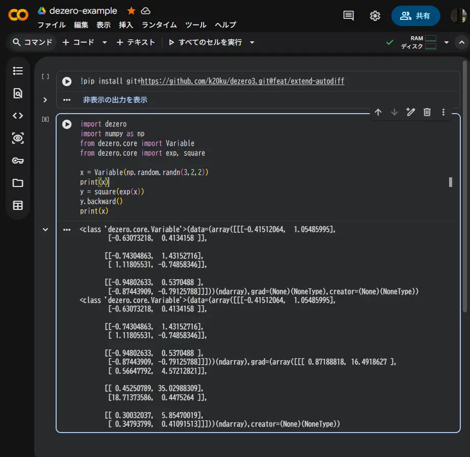
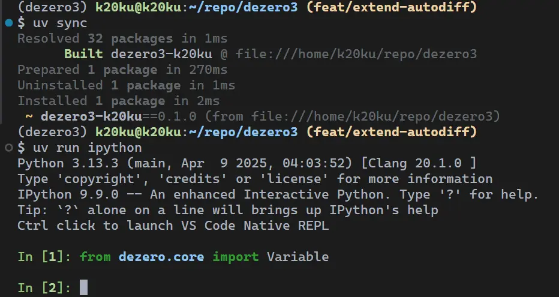
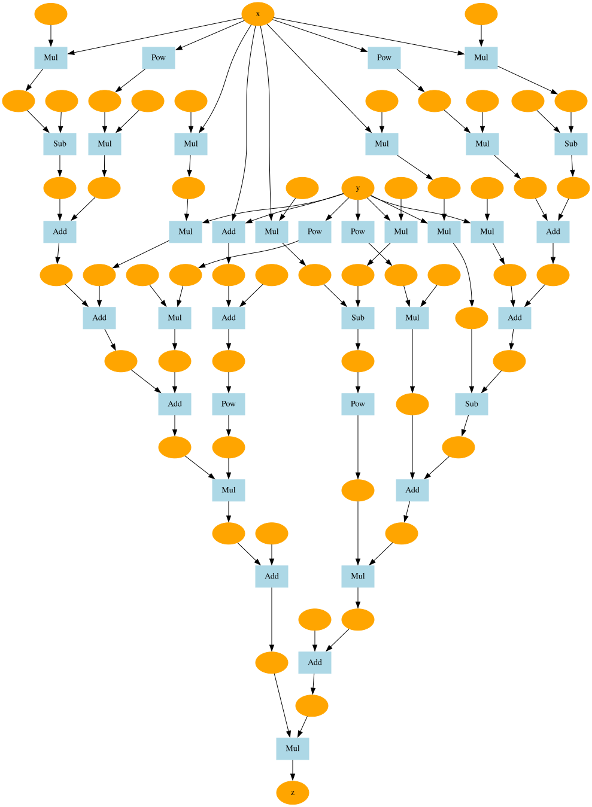

# Modernized Deep Learning Framework From Scratch

Deep Learning Framework repository.

Based on "Deep Learning from Scratch 3" by 斎藤康毅([koki0702](https://github.com/koki0702))

- URL: https://github.com/oreilly-japan/deep-learning-from-scratch-3

Modernized dezero or chainer ML framework adapted to current Python ecosystem and current ML environment.

『ゼロから作る Deep Learning ③』をベースにしたMLフレームワーク実装リポジトリ。

## Developer Notices

- setup dependencies and make `venv` activated.

```bash
uv sync
source .venv/bin/activate
```

## Run Dezero

```bash
uv run main.py
```

### Run in Colab



### Run in IPython REPL



```bash
uv run ipython
```

You can make REPL responsive to module-file changes

```python
%load_ext autoreload
%autoreload all
```

You can run specific script file (i.e. `main.py`) on the REPL.

```python
%run main.py
```

### Jupyter Lab

```
uv run --with jupyter jupyter lab
```

### Tests Dezero

To run all test,

```bash
pytest
```

```bash
# or if you are not in vertual environment
uv run pytest
```

To test specified class or functions (i.e. `class TestSquare` in `tests/core_test.py`)

```bash
pytest tests/core_test.py::TestSquare
```

## Motivation

- Implement as k20ku would like to do because this is not official development but k20ku's own for now.
- Customizable minimal chainer or pytorch
- Several known ML methods based on this repository's autograd
- Add relatively strict type systems since developers (mainly me) can benefit from LSP
- Reusablility by structual library
- More efficint and faster algorithm

## Development Process

This project is librarised koki's Dezero. Original Dezero Book precesses the implementations for each steps as the script. On the other hand, this repository have early aimed to be used by the library.

References are

- DeZero
    - https://github.com/oreilly-japan/deep-learning-from-scratch-3
- NumPy
- Chainer
  - https://docs.chainer.org/en/stable/index.html
  - https://github.com/chainer/chainer
- PyTorch
  - https://github.com/pytorch/pytorch/tree/main/torch/csrc/autograd.

Implemented are

- Variable
- Function
- Computation Graph
- Backward Propagation (basic)
- Gradient Checking
- Add / multiple inputs
- computation graph traversal that enables drawing
    
- broadcasting, sum, matrix multiplication
- Two-Layers model

In implementation,

- Softmax
- NNW usage
- Conv2d, Attention

## Improvements

### project using `uv`

This project heavly relies on [uv](https://docs.astral.sh/uv/) package manager.

### Type Hinting

- `Variable`'s data only accepts Not-None NDArray (numpy.ndarray or cupy.ndarray).
- `Function` class users do not have to cautious from type, it is loosely typed.
- boundary of API and internals strictly typed

Example:

Stricty typed are

- `Variable`
- `Function`
- grad
- internal of computation graph

On the other hand, this project is taking care of user's the Pythonic code.

```python
class Sinh(Fucntion):
    def forward(self, x):
        # x is NDArray
        y = xp.sinh(x)
        return y
    def backward(self, gy):
        # gy is Variable
        x, = self.inputs
        gx = gy * Cosh()(x)
        return gx

class Cosh(Function):
    def forward(self, x):
        y = xp.cosh(x)
        return y
    def backward(self, gy):
        x, = self.inputs
        gx = gy * Sinh()(x)
        return gx
```

```python
def rosenbrock(x0, x1):
    return 100 * (x1 - x0 ** 2) ** 2 + (x0 - 1) ** 2
```

```python
def goldstein_price(x1, x2):
    return (
        1 + (x1 + x2 + 1) ** 2 * (19 - 14 * x1 + 3 * x1**2 + 6 * x1 * x2 + 3 * x2**2)
    ) * (
        30
        + (2 * x1 - 3 * x2) ** 2
        * (18 - 32 * x1 + 12 * x1**2 + 48 * x2 - 36 * x1 * x2 + 27 * x2**2)
    )
```

### test-framwork

Original implementation uses `unittest`. However, this repository uses `pytest` for the reasons below.

- mimimalized compared to `unittest` but has many features.
- parametrize test

Example:

```python
@pytest.mark.parametrize(
    argnames=("data0", "data1", "f"),
    argvalues=[
        (np.random.randn(1), np.random.randn(4), lambda x, y: x + y),
        (np.random.randn(2, 2), np.random.randn(2), lambda x, y: x - y),
        (np.random.randn(3), np.random.randn(), lambda x, y: x * y),
        (np.random.randn(2, 1), np.random.randn(), lambda x, y: x * y),
    ],
    ids=["add", "sub", "mul", "div"],
)
def test_broadcasting(data0: NDArray, data1: NDArray, f: CallableV):...

```

### dynamic type and static type

For feature introduction of `cupy`, static type alias and dynamic type(`ndarray`) is defined.

```python
type NDArray = np.ndarray

xp = np

ndarray = xp.ndarray
```

- Dynamic type usage

```python
isinstance(x, ndarray)
```

- Static type usage

```python
def f() -> NDArray:...
```

Basically `np.multi_index` is too primitive to use these days.

Bottleneck of numerical diff is `f` that creates the graph for each index. 
Therefore, so is alternate to `np.ndindex` + `for` loop.

### Benchmark

```bash
uv run benchmarks/dangling.py
```

| Mode      | During computation | Before GC | After GC |
| --------- | -----------------: | --------: | -------: |
| With Grad |            +6.4 MB |   +8.0 MB |   +836 B |
| No Grad   |            +0.8 MB |   +0.8 MB |   +176 B |

### To $\LaTeX$ for matplotlib caption or documentation

For Matplotlib caption.

Writing LaTeX representation of cmp-graph by hand is a hard job, so this project implements `to_latex` function that traverses cmp-graph and gain a tidy LaTeX string.

```py
import dezero.functions as F
from dezero import variable
from dezero.utils.expr import to_latex

x0 = dc.variable(2, name="x0")
x1 = dc.variable(3, name="x1")
y = F.exp(-(F.sin((x0 + x1) ** 2) + 1))

to_latex(y) # 'e^{- 1.0 - \\sin{\\left(\\left(x_{0} + x_{1}\\right)^{2} \\right)}}'

y.backward(create_graph=True)
gx0 = x0.grad

to_latex(gx0) # '- 1.0 \\cdot 2.0 \\left(x_{0} + x_{1}\\right) e^{- 1.0 - \\sin{\\left(\\left(x_{0} + x_{1}\\right)^{2} \\right)}} \\cos{\\left(\\left(x_{0} + x_{1}\\right)^{2} \\right)}'
```

`to_latex` output

- $y = e^{- 1.0 - \sin{\left(\left(x_{0} + x_{1}\right)^{2} \right)}}$

- $\frac{\partial y}{\partial y} = - 1.0 \cdot 2.0 \left(x_{0} + x_{1}\right) e^{- 1.0 - \sin{\left(\left(x_{0} + x_{1}\right)^{2} \right)}} \cos{\left(\left(x_{0} + x_{1}\right)^{2} \right)}$

### Support `SupportsIndex` and `Shape`, `@overload`

Original dezero uses `tuple[int]`. This project utilize `SupportsIndex` respecting numpy API.

```python
class Variable:
    ...
    @overload
    def reshape(self, shape: ShapeLike | None, /) -> Variable: ...
    @overload
    def reshape(self, /, *shape: SupportsIndex) -> Variable: ...
    def reshape(self, *shape: Any):
        # implementations
```
